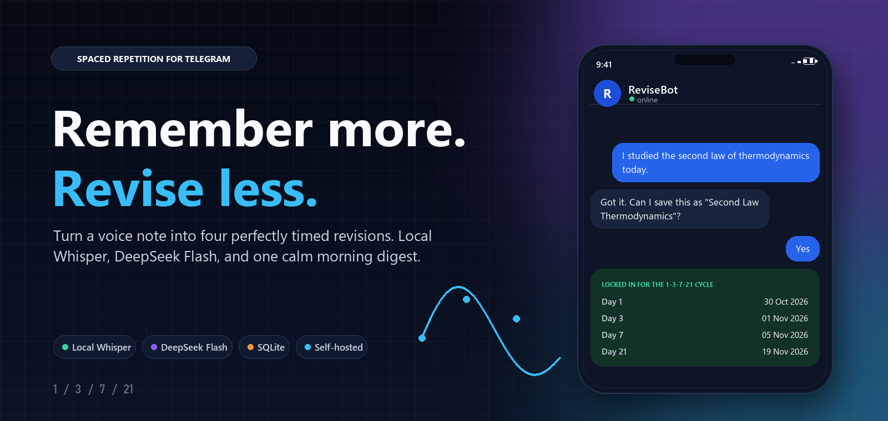
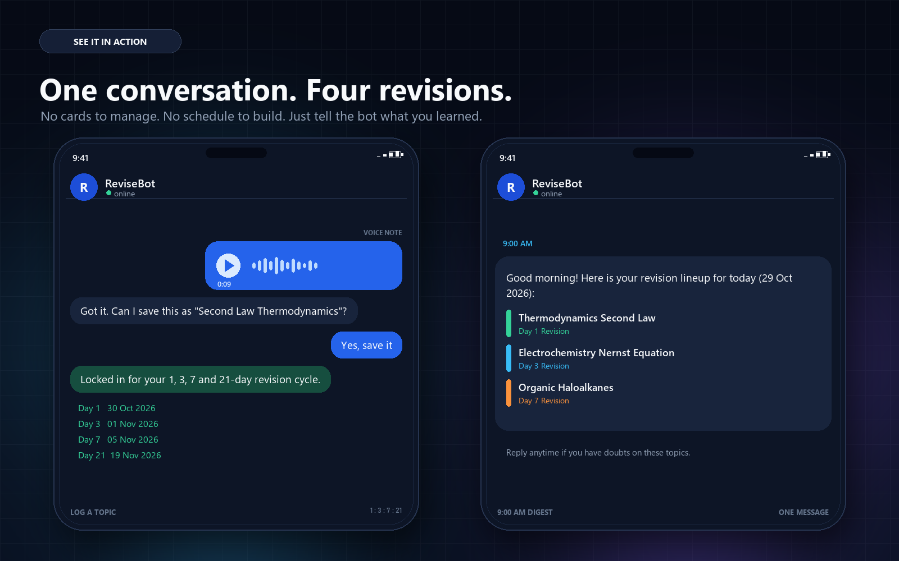
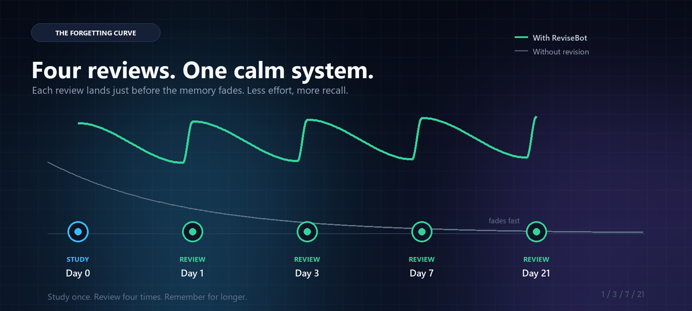

# ReviseBot

<p align="center">
  
</p>

<p align="center">
  <a href="https://github.com/devalcodes/spaced-repetition-bot"></a>
  <a href="https://core.telegram.org/bots/api"></a>
  
  
  <a href="LICENSE"></a>
</p>

<p align="center">
  <strong>Turn a voice note into four perfectly timed revisions.</strong><br>
  A self-hosted Telegram study bot built on the 1, 3, 7 and 21-day forgetting curve.
</p>

<p align="center">
  <a href="#quickstart"><strong>Quickstart</strong></a> &nbsp;·&nbsp;
  <a href="#one-paste-ai-setup"><strong>AI setup</strong></a> &nbsp;·&nbsp;
  <a href="#commands"><strong>Commands</strong></a> &nbsp;·&nbsp;
  <a href="#deploy"><strong>Deploy</strong></a>
</p>

---

## Why ReviseBot

Most study systems give you more things to manage: cards, decks, tags, dashboards, reminders.

ReviseBot does the opposite. You tell it what you learned. It gives the topic a short title, asks you to confirm it, and schedules four reviews. Then it gets out of your way until the morning digest.

No dashboard. No manual scheduling. No 21 separate notifications.

---

## See it in action

<p align="center">
  
</p>

One conversation creates the whole revision cycle. One message each morning tells you what to revisit.

---

## The 1-3-7-21 method

<p align="center">
  
</p>

The Ebbinghaus forgetting curve shows that memory drops fastest right after learning. A review placed just before the drop interrupts that forgetting.

| When | What happens |
|---|---|
| Day 0 | You study something and tell the bot. |
| Day 1 | First review, while the memory is fresh. |
| Day 3 | Second review, as recall starts to weaken. |
| Day 7 | Third review, rebuilding the memory with less effort. |
| Day 21 | Final review, moving the topic toward long-term memory. |

Study once. Review four times. Remember for longer.

---

## What you get

- **Voice first.** Send a Telegram voice note. Local Whisper transcribes it, and the bot turns it into a clean study topic.
- **One morning digest.** Every due topic appears in a single message at your chosen time. No notification spam.
- **A brain you control.** Use DeepSeek, OpenAI, Gemini, Groq, OpenRouter, or a local Ollama model.
- **Local speech by default.** Audio is transcribed on your machine with `faster-whisper`. No extra API key and no system FFmpeg.
- **Your data stays yours.** Topics, revision dates, drafts, and chat context live in one local SQLite file.
- **It fits in your pocket.** One Python process, one SQLite file, no inbound ports, no web dashboard to maintain.

---

## Quickstart

**You need:** Python 3.10 or newer, a Telegram bot token, and an API key for one OpenAI-compatible LLM provider.

### 1. Clone and install

```bash
git clone https://github.com/devalcodes/spaced-repetition-bot.git
cd spaced-repetition-bot

python -m venv .venv

# macOS / Linux
source .venv/bin/activate

# Windows PowerShell
# .venv\Scripts\Activate.ps1

pip install -r requirements.txt
```

### 2. Create your Telegram bot

1. Open [@BotFather](https://t.me/BotFather) in Telegram.
2. Send `/newbot`.
3. Choose a display name and a username ending in `bot`.
4. Copy the token BotFather gives you.

### 3. Create `.env`

```bash
cp .env.example .env
```

On Windows PowerShell:

```powershell
Copy-Item .env.example .env
```

Open `.env` and fill in at least:

```env
TELEGRAM_BOT_TOKEN=your_bot_token
TIMEZONE=Asia/Kolkata
REMINDER_HOUR=9
REMINDER_MINUTE=0

LLM_BASE_URL=https://api.deepseek.com
LLM_API_KEY=your_deepseek_key
LLM_MODEL=deepseek-flash

STT_MODE=local
LOCAL_WHISPER_MODEL=base
```

### 4. Run

```bash
python main.py
```

You should see:

```text
Connected to Telegram as @your_bot_username
LLM model: deepseek-flash at https://api.deepseek.com
STT: local faster-whisper model=base
```

Open your bot, press **Start**, and send:

```text
I studied the second law of thermodynamics today. Entropy always increases in an isolated system.
```

Confirm the proposed title. Your four revision dates are now scheduled.

> **First voice note:** with `STT_MODE=local`, the Whisper model downloads once on first use. After that, transcription is fully offline.

---

## One-paste AI setup

Not comfortable with terminal commands? Let an AI coding agent do the full setup.

1. Open this folder in **Claude Code**, **Codex**, **Cursor**, **Windsurf**, or **DeepSeek Harness**.
2. Open [AI_SETUP_PROMPT.md](AI_SETUP_PROMPT.md).
3. Copy the prompt and paste it into the agent.

The agent will find the project, guide you through BotFather, ask for your API key, write `.env` safely, install dependencies, test text and voice notes, and help you set up production auto-restart.

---

## Choose your AI

Any OpenAI-compatible endpoint works. Pick one block and place it in `.env`.

| Provider | Base URL | Model |
|---|---|---|
| **DeepSeek direct** | `https://api.deepseek.com` | `deepseek-flash` |
| **OpenRouter** | `https://openrouter.ai/api/v1` | `deepseek/deepseek-v4.1-flash-1017` |
| **OpenAI** | `https://api.openai.com/v1` | `gpt-4o-mini` |
| **Google Gemini** | `https://generativelanguage.googleapis.com/v1beta/openai/` | `gemini-2.5-flash` |
| **Groq** | `https://api.groq.com/openai/v1` | `llama-3.3-70b-versatile` |
| **Local Ollama** | `http://localhost:11434/v1` | `llama3.1` |

DeepSeek direct example:

```env
LLM_BASE_URL=https://api.deepseek.com
LLM_API_KEY=your_deepseek_key
LLM_MODEL=deepseek-flash
```

OpenRouter example:

```env
LLM_BASE_URL=https://openrouter.ai/api/v1
LLM_API_KEY=your_openrouter_key
LLM_MODEL=deepseek/deepseek-v4.1-flash-1017
```

Ollama does not need a real key. Any non-empty value works.

---

## Voice notes

### Local and offline (default)

```env
STT_MODE=local
LOCAL_WHISPER_MODEL=base
LOCAL_WHISPER_LOCAL_FILES_ONLY=false
```

Uses `faster-whisper` on CPU with `int8`. Telegram `.ogg` files are decoded by bundled PyAV, so **you do not need system FFmpeg**.

If the model is already cached and you want to guarantee no downloads:

```env
STT_MODE=local
LOCAL_WHISPER_MODEL=C:/Users/you/.cache/huggingface/hub/models--Systran--faster-whisper-base/snapshots/your-snapshot
LOCAL_WHISPER_LOCAL_FILES_ONLY=true
```

The folder must contain `model.bin`, `config.json`, `tokenizer.json`, and `vocabulary.txt`.

### Cloud Whisper (optional)

```env
STT_MODE=api
STT_BASE_URL=https://api.groq.com/openai/v1
STT_API_KEY=your_groq_key
STT_MODEL=whisper-large-v3-turbo
```

Works with Groq Whisper, OpenAI Whisper, or any compatible transcription endpoint.

---

## Commands

| Command | What it does |
|---|---|
| `/start` | Welcome message and a short explanation of the method. |
| `/today` | Show revisions due today. |
| `/schedule` | Show every saved topic with all four revision dates. |
| `/seed_demo` | Replace this chat's topics with three demo topics due today. |
| `/test_morning` | Send today's morning digest immediately. |

You can also talk normally:

```text
I studied SN1 and SN2 reactions in haloalkanes today.
Yes, save it.
Call it Haloalkane Substitution instead.
What do I need to revise today?
What was my note on the Nernst equation?
Delete the electrochemistry topic.
```

> `/seed_demo` removes existing topics for that chat. Use it for testing and demos only.

---

## Deploy

The bot uses long polling, so it needs no inbound ports or public domain. Keep the process running and the machine awake at your reminder time.

### Linux with systemd

```ini
[Unit]
Description=ReviseBot Telegram study bot
After=network-online.target
Wants=network-online.target

[Service]
Type=simple
User=revisebot
WorkingDirectory=/opt/revisebot
ExecStart=/opt/revisebot/.venv/bin/python main.py
Restart=always
RestartSec=5
Environment=PYTHONUNBUFFERED=1

[Install]
WantedBy=multi-user.target
```

```bash
sudo systemctl daemon-reload
sudo systemctl enable --now revisebot
sudo systemctl status revisebot
```

### Windows

Use Task Scheduler or NSSM to run `.venv\Scripts\python.exe main.py` from the project folder at login or boot. Send logs to a file so failures are visible.

### Production checklist

- Run exactly one bot instance per token. A second instance causes a `409 Conflict`.
- Back up `study_memory.db` regularly.
- Keep `.env` private and rotate keys if it is ever exposed.
- The daily job is held in memory. If the bot is offline at reminder time, that digest is not replayed automatically.
- No inbound firewall ports are needed.

---

## Configuration

| Variable | Default | Purpose |
|---|---|---|
| `TELEGRAM_BOT_TOKEN` | required | Bot token from BotFather. |
| `TIMEZONE` | `Asia/Kolkata` | Any IANA timezone. |
| `REMINDER_HOUR` | `9` | Daily digest hour, 0 to 23. |
| `REMINDER_MINUTE` | `0` | Daily digest minute, 0 to 59. |
| `LLM_BASE_URL` | `https://api.deepseek.com` | OpenAI-compatible LLM endpoint. |
| `LLM_API_KEY` | required | Key for your LLM provider. |
| `LLM_MODEL` | `deepseek-flash` | Model name. |
| `STT_MODE` | `local` | `local` or `api`. |
| `LOCAL_WHISPER_MODEL` | `base` | Model name or local folder path. |
| `LOCAL_WHISPER_LOCAL_FILES_ONLY` | `false` | Set to `true` to forbid model downloads. |
| `STT_BASE_URL` | `https://api.openai.com/v1` | Cloud transcription endpoint. |
| `STT_API_KEY` | empty | Required only when `STT_MODE=api`. |
| `STT_MODEL` | `whisper-1` | Cloud transcription model. |

---

## Project structure

```text
spaced-repetition-bot/
├── assets/              # README banner, preview, and timeline graphics
├── .env.example         # Configuration template
├── .gitignore
├── AI_SETUP_PROMPT.md   # Copy-paste setup prompt for AI coding agents
├── LICENSE
├── README.md
├── database.py          # SQLite schema and data access
├── transcriber.py       # Local and API speech-to-text
├── agent.py             # LLM prompt, tools, and tool-calling loop
├── scheduler.py         # Morning digest formatter and JobQueue job
├── main.py              # Telegram handlers, commands, and startup
└── requirements.txt
```

Database file at runtime: `study_memory.db`

---

## Troubleshooting

**`401 Authentication Fails`**
The LLM rejected `LLM_API_KEY`. Create a fresh key with your provider and restart. Speech-to-text is not the problem.

**The bot is running but never replies**
Check the startup log for the connected username. If it is not the bot you are messaging, a stale `TELEGRAM_BOT_TOKEN` is overriding `.env`. The project loads `.env` with `override=True`, so restart the process.

**`409 Conflict`**
Another instance is polling the same token. Stop all other copies.

**`JobQueue is unavailable`**
Install the requirements again. The file includes `python-telegram-bot[job-queue]`.

**Local Whisper fails**
Verify `LOCAL_WHISPER_MODEL` points to a folder containing `model.bin`, or set it to `base` and let the first run download the model.

**The morning digest did not arrive**
Confirm the process was running at reminder time and the timezone is correct. The job does not replay missed digests.

---

## Privacy

- No telemetry, analytics, or third-party tracking.
- Study data and conversation history stay in local SQLite.
- Local Whisper keeps audio on your machine.
- If you use `STT_MODE=api`, the voice file is sent to your chosen transcription provider.
- Your LLM provider receives the text needed to title, summarize, and schedule topics.

---

## License

MIT. See [LICENSE](LICENSE).

<p align="center">
  <sub>Built for people who want to learn, not manage a system.</sub>
</p>
